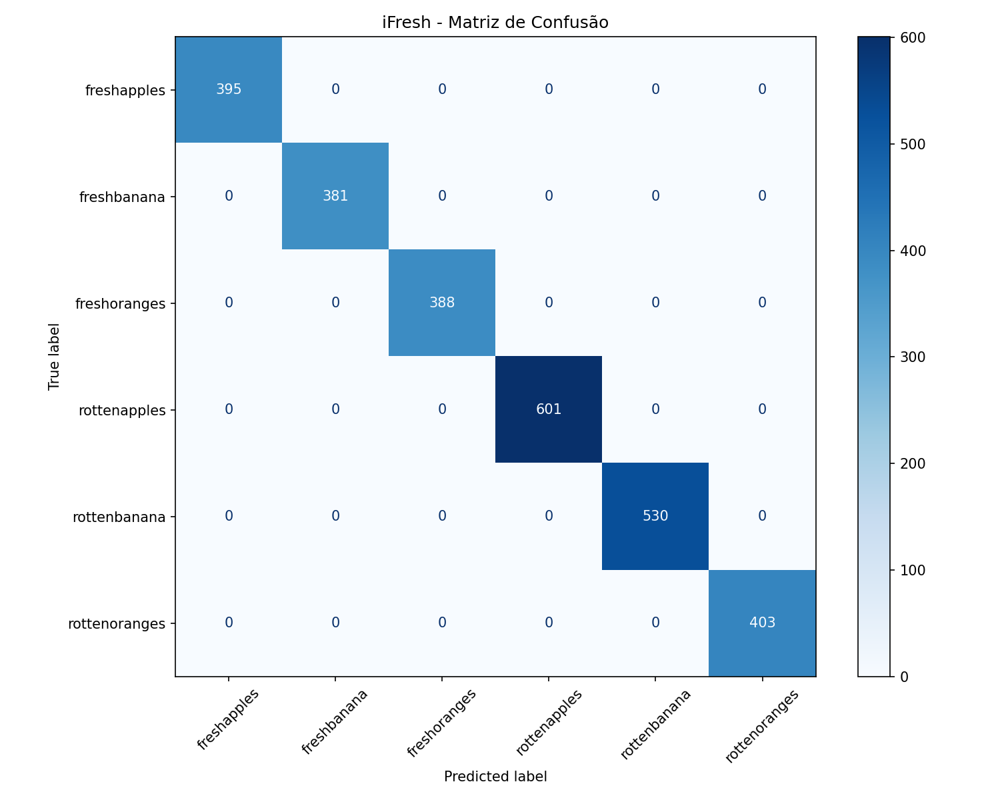

# iFresh 🍎

Projeto de Machine Learning com foco em Visão Computacional, desenvolvido para identificar sinais visuais de deterioração em frutas.

O iFresh utiliza um modelo YOLO de classificação de imagens para reconhecer maçãs, bananas e laranjas, classificando-as como frescas ou deterioradas.

## Tecnologias

- Python
- YOLO (Ultralytics)
- PyTorch
- scikit-learn
- Matplotlib

## Dataset

Foi utilizado o dataset **Fruits Fresh and Rotten for Classification**, disponibilizado no Kaggle.

O conjunto contém 13.599 imagens, divididas em seis classes:

- Fresh Apples
- Fresh Banana
- Fresh Oranges
- Rotten Apples
- Rotten Banana
- Rotten Oranges

As imagens foram organizadas em três conjuntos:

| Conjunto | Imagens |
|---|---:|
| Treinamento | 8.718 |
| Validação | 2.183 |
| Teste | 2.698 |

Dataset: https://www.kaggle.com/datasets/sriramr/fruits-fresh-and-rotten-for-classification

## Desenvolvimento

O projeto utiliza Transfer Learning com um modelo YOLO pré-treinado, adaptado para classificar as seis categorias de frutas.

O desenvolvimento envolveu:

1. Preparação e organização do dataset.
2. Divisão dos dados em treinamento, validação e teste.
3. Treinamento do modelo durante 10 épocas.
4. Avaliação com scikit-learn.
5. Implementação de inferência em novas imagens.

## Resultados

O modelo alcançou **100% de acurácia no conjunto de teste**, composto por 2.698 imagens.

A avaliação incluiu:

- Accuracy
- Precision
- Recall
- F1-score
- Matriz de confusão



O resultado foi obtido no dataset utilizado e não garante o mesmo desempenho em fotografias externas. Ainda é necessário investigar possíveis duplicações ou semelhanças entre os conjuntos de imagens.

## Como executar

### 1. Instalar as dependências

```bash
python3 -m pip install -r requirements.txt
```

### 2. Preparar o dataset

Baixe o dataset no Kaggle e organize suas pastas em `dataset/train` e `dataset/test`.

Execute:

```bash
python3 prepare_dataset.py
```

Execute a preparação apenas uma vez, pois ela move parte das imagens de treinamento para validação.

### 3. Treinar o modelo

```bash
python3 train.py
```

### 4. Avaliar o modelo

```bash
python3 evaluate.py
```

### 5. Classificar uma imagem

```bash
python3 predict.py
```

O script de previsão abre um seletor de arquivos no macOS e apresenta a fruta identificada, seu estado visual e a confiança da previsão.

Para executar a previsão, é necessário ter os pesos treinados em `runs/classify/runs/ifresh/weights/best.pt`.

## Limitações

- Reconhece apenas maçãs, bananas e laranjas.
- Não possui reconhecimento confiável de alimentos desconhecidos.
- Pode apresentar desempenho diferente em fotografias externas.
- A classificação visual não determina se um alimento é seguro para consumo.

## Objetivo

O iFresh foi desenvolvido como projeto pessoal para explorar conceitos de Machine Learning, Transfer Learning, classificação de imagens e avaliação de modelos de Visão Computacional.
